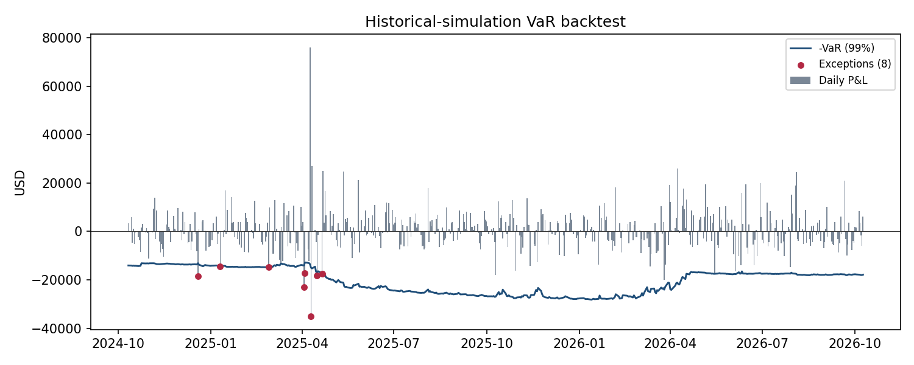

# Market Risk VaR Engine

A small, end-to-end market risk workflow in Python: validate market data, measure the
1-day Value at Risk and Expected Shortfall of a multi-asset book three ways, report
Greeks and risk contributions, backtest the model, and write a daily risk report.

## What it does

| Step | Module | Output |
|---|---|---|
| Data validation | `validation.py` | Calendar alignment, stale prices, outlier returns, logged as issues |
| Pricing and Greeks | `greeks.py`, `portfolio.py` | Black-Scholes price, delta, gamma, vega, theta |
| VaR and ES | `var_models.py` | Historical simulation, parametric (delta-normal), Monte Carlo |
| Risk attribution | `var_models.py` | Component VaR by risk factor |
| Backtesting | `backtest.py` | Exceptions, Kupiec POF test, Basel traffic-light zone |
| Reporting | `report.py`, `run_report.py` | Markdown report and backtest chart |

## Portfolio

A USD-based book with four risk factors (SPY, TLT, EURUSD, VIX):

- 1,000 SPY shares (equity)
- 2,000 TLT shares (long-duration Treasuries, a rates proxy)
- EUR 500,000 cash (FX)
- 2,000 SPY calls, 3-month, struck 5% out of the money (non-linear equity and vega risk;
  VIX/100 is used as the implied volatility)

## Methods

- **Historical simulation**: replays each of the last 500 days' factor moves on today's
  book with full revaluation of the options.
- **Parametric (delta-normal)**: linear exposures and a normal distribution of factor
  returns; also gives component VaR by factor.
- **Monte Carlo**: 20,000 correlated normal scenarios (Cholesky), full revaluation.
- **Expected Shortfall** at 99% for each method and at 97.5% (the FRTB measure).
- **Backtest**: 500 days of rolling 250-day historical-simulation VaR against hypothetical
  P&L, with the Kupiec proportion-of-failures test and the Basel traffic light.

## Sample output (as of 2026-10-09)

| Method | 1-day 99% VaR | 99% ES |
|---|---:|---:|
| Historical simulation | $22,859 | $36,258 |
| Parametric (delta-normal) | $25,860 | $29,627 |
| Monte Carlo | $24,896 | $28,456 |

Backtest: 8 exceptions in 500 days (5 expected), Kupiec p = 0.215, traffic light GREEN.



## Run it

```bash
python -m venv .venv && source .venv/bin/activate
pip install -r requirements.txt
python run_report.py --refresh     # download prices and write reports/risk_report_<date>.md
pytest -q                          # sanity tests against closed-form answers
```

## Assumptions and limitations

- VIX stands in for the calls' implied volatility, and the risk-free rate is flat at 4%.
- TLT is used as a proxy for interest-rate risk instead of a yield curve.
- The horizon is 1 day; regulatory 10-day measures and liquidity horizons are not modeled.
- Historical simulation reacts sharply when a stress day enters or leaves the window
  (visible in the backtest chart around April 2025 and April 2026).

## Possible extensions

Stressed VaR on a fixed stress window, the Christoffersen independence test, 10-day
scaling, and FRTB standardized-approach sensitivities.
